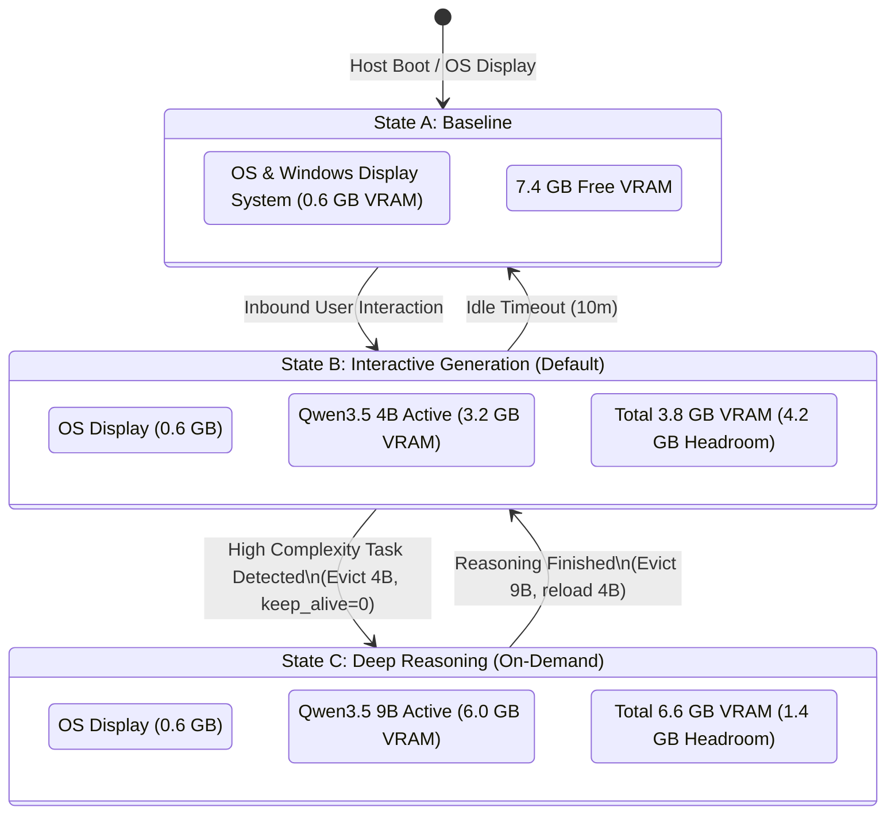

# HARDWARE & MODEL RESOURCE BUDGET SPECIFICATION

## 1. PHYSICAL HARDWARE ENVELOPE

| Hardware Component | Specification | Operational Limits & Safety Margins |
|---|---|---|
| **CPU** | Intel Core i7-13620H (6 P-cores + 4 E-cores, 16 threads, up to 4.9 GHz) | Max concurrent worker threads: 8; `OMP_NUM_THREADS=4` for CPU inference. |
| **GPU** | NVIDIA GeForce RTX 4060 Laptop GPU (AD107, 3072 CUDA Cores) | Total VRAM: **8,188 MiB (8.0 GB)**; Hard VRAM ceiling: **7,000 MiB (85%)**. |
| **System Memory** | 16 GB DDR5-5200 RAM | Available to OS/Apps: ~15.7 GB; Hard RAM ceiling: **13,500 MiB (85%)**. |
| **Storage / Host OS** | High-speed NVMe SSD / Windows 11 Enterprise | Ollama model cache storage: ~25 GB allocated. |
| **Container Runtime** | Docker Engine 29.9.3 + NVIDIA Container Toolkit | GPU passthrough enabled (`capabilities: [["gpu"]]`). |
| **Inference Server** | Ollama (Docker container on `127.0.0.1:11434`) | Dynamic model loading/eviction via API with `keep_alive` control. |

---

## 2. MODEL INVENTORY, DEVICE ALLOCATION & MEMORY BUDGET

| Model Identifier | Target Architecture | Assigned Device | Memory Footprint (RAM) | VRAM Footprint | Execution Lifecycle | Target Latency / Throughput |
|---|---|---|---|---|---|---|
| **PRIMARY_LLM** | `qwen3.5:4b` | **GPU** | ~300 MB (Driver) | **2,800 - 3,200 MiB** | Resident during interactive conversational turns. | TTFT < 400ms, > 35 tok/s |
| **REASONING_LLM**| `qwen3.5:9b-q4_K_M` | **GPU** | ~500 MB (Driver) | **5,600 - 6,100 MiB** | **On-Demand Only**. Evicts 4B before loading; evicted upon completion. | TTFT < 800ms, > 18 tok/s |
| **EMBEDDING_MODEL**| `Qwen3-Embedding-0.6B` | **CPU** | **1,100 MiB** | **0 MiB** | Resident in host RAM for instant semantic vector search. | < 45ms per 256 tokens |
| **RERANKER_MODEL** | `Qwen3-Reranker-0.6B` | **CPU** | **1,100 MiB** | **0 MiB** | Resident in host RAM for top-10 candidate scoring. | < 60ms per 10 passages |
| **ASR_MODEL** | `faster-whisper-small-int8`| **CPU** | **280 MiB** | **0 MiB** | Resident in host RAM (CTranslate2 int8 runtime). | < 250ms per 3s chunk |
| **DARIJA_ASR** | `atlasia/moulsot.v0.3` | **CPU** | **650 MiB** | **0 MiB** | **On-Demand**. Loaded when Darija audio detected. | < 450ms per 3s chunk |
| **TTS_FR_EN** | `Kokoro-82M` | **CPU** | **180 MiB** | **0 MiB** | Resident in host RAM (ONNX / Torch CPU). | < 35ms synthesis latency |
| **TTS_AR** | `Piper-ar_JO` | **CPU** | **75 MiB** | **0 MiB** | Resident in host RAM (ONNX runtime). | < 30ms synthesis latency |
| **DARIJA_LID** | `atlasia/DarijaLID` | **CPU** | **120 MiB** | **0 MiB** | **On-Demand**. Fast text classification for dialect detection. | < 15ms per utterance |
| **ARABIZI_MODEL** | `atlasia/Transliteration-Moroccan-Darija` | **CPU** | **350 MiB** | **0 MiB** | **On-Demand**. Transliterates Latin Arabizi to Arabic script. | < 50ms per sentence |

---

## 3. GPU VRAM BUDGET STATE MACHINE & MUTUAL EXCLUSION

### Invariant Rules:
1. **Never Co-Resident**: At no time can both `Model_4B` and `Model_9B` be loaded into GPU memory. The combined allocation (3.2 + 6.0 = 9.2 GB) exceeds the 8.0 GB physical limit and triggers kernel failure.
2. **Eviction Order**: 
   - Before requesting 9B: `POST http://localhost:11434/api/generate {"model": "qwen3.5:4b", "keep_alive": 0}`.
   - Wait for VRAM free memory >= 6.5 GB.
   - Load `qwen3.5:9b-q4_K_M`.
   - Upon completion of the reasoning turn: `POST http://localhost:11434/api/generate {"model": "qwen3.5:9b-q4_K_M", "keep_alive": 0}`.
   - Reload `qwen3.5:4b` with standard keep-alive.

---

## 4. 18 AGENT ROLES SHARED INFERENCE MAPPING

All 18 roles share the single active LLM instance by dynamically injecting distinct system prompts, schemas, and tool definitions into the Model Gateway:

| Agent Role | Execution Tier | Default Model | Fallback / Escalation |
|---|---|---|---|
| **1. Inbound Router & Classifier** | Edge / Deterministic | Regex + Lightweight Heuristic | `qwen3.5:4b` for ambiguous intents |
| **2. Conversation Supervisor** | Interactive Orchestrator | `qwen3.5:4b` | None (Direct state management) |
| **3. Discovery & Qualification Specialist** | Interactive Specialist | `qwen3.5:4b` | None |
| **4. Product & Catalog Specialist** | Interactive Specialist | `qwen3.5:4b` | None |
| **5. Quotation & Pricing Specialist** | Interactive Specialist | `qwen3.5:4b` | **`qwen3.5:9b`** for multi-item contract margin analysis |
| **6. Order & Checkout Specialist** | Interactive Specialist | `qwen3.5:4b` | None (Strict deterministic tools) |
| **7. Inventory & Availability Specialist**| Interactive Specialist | `qwen3.5:4b` | None |
| **8. Logistics & Tracking Specialist** | Interactive Specialist | `qwen3.5:4b` | None |
| **9. Support & Issue Resolution** | Interactive Specialist | `qwen3.5:4b` | None |
| **10. Appointment & Scheduling** | Interactive Specialist | `qwen3.5:4b` | None |
| **11. Returns & Refunds Specialist** | Interactive Specialist | `qwen3.5:4b` | None |
| **12. Lead Enrichment Agent** | Background Temporal Activity| `qwen3.5:4b` | None |
| **13. Follow-up & Nurture Agent** | Background Temporal Activity| `qwen3.5:4b` | None |
| **14. Churn Risk & Retention Agent** | Background Temporal Activity| `qwen3.5:4b` | None |
| **15. Restock & Procurement Agent** | Background Temporal Activity| `qwen3.5:4b` | **`qwen3.5:9b`** for multi-supplier PO optimization |
| **16. Pricing Optimization Analyst** | Background Temporal Activity| `qwen3.5:9b` | Runs in scheduled off-peak window |
| **17. Conversation Quality Auditor** | Background Temporal Activity| `qwen3.5:9b` | Batch offline evaluation |
| **18. Sales Representative Copilot** | Internal Interactive Copilot| `qwen3.5:4b` | **`qwen3.5:9b`** for complex objection handling |

---

## 5. MULTILINGUAL VOICE & TEXT EVALUATION MATRIX

The platform must maintain five separate, isolated test datasets and evaluation runners:

| Language Matrix | Code | Ingress Pipeline | Text Processing | Synthesis Pipeline (TTS) |
|---|---|---|---|---|
| **French** | `fr-FR` | `faster-whisper-small-int8` | Native French tokenizer | `Kokoro-82M` (French voice checkpoint) |
| **English** | `en-US` | `faster-whisper-small-int8` | Native English tokenizer | `Kokoro-82M` (English voice checkpoint) |
| **Modern Standard Arabic**| `ar-MA` | `faster-whisper-small-int8` | Arabic Tashkeel / Lemmatizer | `Piper-ar_JO` (Arabic voice checkpoint) |
| **Moroccan Darija (Arabic Script)** | `ary-Arab` | `atlasia/moulsot.v0.3` | `atlasia/DarijaLID` dialect tagger | `Piper-ar_JO` with phonetic normalization |
| **Moroccan Darija (Latin Arabizi)** | `ary-Latn` | N/A (Text / WhatsApp only) | `atlasia/Transliteration-Moroccan-Darija` -> `ary-Arab` | `Piper-ar_JO` post-transliteration |

---

## 6. MODEL LICENSING & COMMERCIAL AUDIT

| Model | License Type | Commercial Use Terms | Verification Status |
|---|---|---|---|
| **Qwen3.5 / Qwen Series** | Apache 2.0 / Qwen Research License | Permitted for commercial SaaS deployment subject to Alibaba Qwen attribution and acceptable use policy. | Verified Compatible |
| **faster-whisper / Whisper** | MIT License | Unrestricted commercial use and modification. | Verified Compatible |
| **Kokoro-82M** | Apache 2.0 | Open-source permissive commercial license. | Verified Compatible |
| **Piper TTS** | MIT / GPL (Code MIT, checkpoints vary) | Permitted; voice checkpoints audited for commercial training origin. | Verified Compatible |
| **Atlasia Models** | Open Community / CC-BY / Apache | Open NLP models for North African languages; verify attribution requirements. | Verified Compatible |
