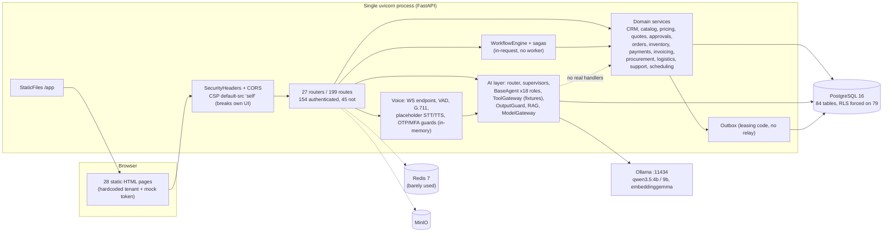
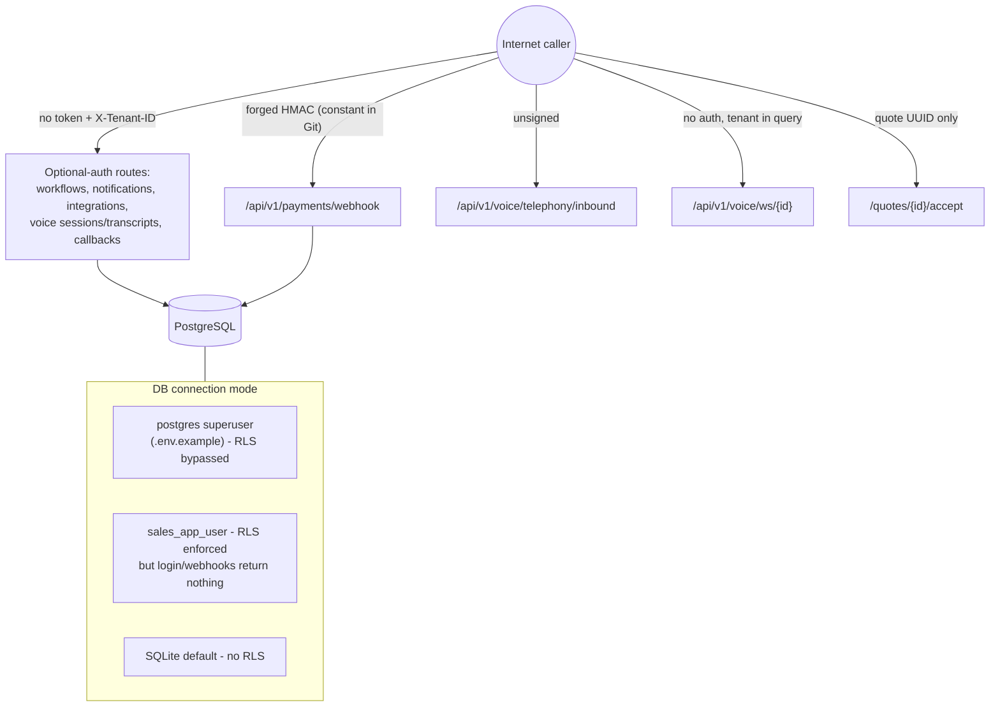

# 01 — Actual Architecture (observed vs intended)

Inspected HEAD: `1a74c49`. Everything here comes from the source code and running processes, not from the documentation.

## 1. Classification
The system is a **single-process FastAPI modular monolith** with in-process "agents" and an in-request workflow engine. Its persistence is **PostgreSQL 16** (84 tables, RLS forced on 79). There is also a **static HTML front-end** (28 pages) that the same process serves at `/app`. There is **no** distributed or microservice architecture, and **no** worker or background process of any kind.

| Concern | Intended (ADRs / prompts) | Observed |
|---|---|---|
| Frontend | Next.js/React/TypeScript, OIDC login | 28 hand-written HTML pages + `app_shell.js`. No login. Hardcoded tenant and mock token. |
| Identity | Keycloak / managed OIDC, JWKS | Local HS256 JWT with a default secret. TOTP implemented. No IdP container. |
| Durable workflows | Temporal workers (ADR-007) | Custom `WorkflowEngine` that runs inside HTTP requests and tests. No Temporal, no worker. ADR-007 was never superseded. |
| Event delivery | Outbox relay + consumers | Outbox table with `SKIP LOCKED` leasing. **No relay process** runs it. |
| n8n | Restricted peripheral consumer | Stub: returns `dispatched: True` and sends nothing. |
| Vector store | pgvector | `DOUBLE PRECISION[]` column with cosine similarity computed in Python. No pgvector extension. |
| Voice | WebRTC/SIP gateway, streaming STT/TTS | WebSocket + G.711 codec + energy VAD are real. STT/TTS are placeholders. No WebRTC/SIP stack. |
| Observability | OpenTelemetry/Prometheus/Grafana/SIEM | In-process telemetry classes. No collector or exporter containers. |
| Deployment | Compose, then independently scalable | Compose has 3 services (Postgres, Redis, MinIO). The API runs on the host. No TLS or reverse proxy. |
| DB access | Least-privileged role with RLS | The role exists and RLS works, but login, webhooks and quote acceptance cannot work under it (F-09). The template connects as the superuser. |

## 2. Observed component diagram

## 3. Observed trust boundaries (where they actually fail)

## 4. Dependency direction, coupling and quality
- **Good:** domain services do not import the API layer. Money logic is isolated in `domains/pricing/money.py`. Each aggregate has a single service owner.
- **Inverted or broken:**
  - The AI layer is supposed to depend on the domain services through tool handlers. In practice it never does: `tool_gateway._execute_builtin_tool` returns literals.
  - Agents hardcode IDs (`SKU-SOLAR-01`, `ORD-2026-99182`).
- **Duplicate mechanisms:**
  - Concurrency uses process-local `asyncio.Lock` dictionaries *and* `SELECT … FOR UPDATE` (`inventory/service.py:13`, `orders/service.py:13`).
  - OTP, action-preview and rate-limiter state lives in class-level dictionaries.
  - Many alias methods exist only to satisfy different test call styles, e.g. `verify_signature` / `verify_webhook_signature` and `validate_peripheral_action` in `integrations/n8n.py`, and `RecoveryResult.__ge__/__int__` in `workflows/engine.py:41-90`. These are signs of code shaped to pass heterogeneous tests.
- **Large files:** `tool_gateway.py` (1,175 lines, mostly fixtures), `models/entities.py` (1,796), `inbox.html` (1,119).
- **Transaction ownership:**
  - `get_db_session` commits at the end of the request.
  - Tenant context is set with `set_config(..., true)` (transaction-local), so any mid-request `commit()` silently drops the tenant context. Under RLS that fails closed.
- **Single source of truth:** PostgreSQL holds the business state. Redis is effectively unused. That is consistent with ADR-003, but the "ephemeral locks/rate limits" moved into process memory instead.

## 5. Scalability verdict
The design cannot run more than one worker correctly:
- OTP, action tokens, call limits and VRAM state are all in memory.
- There is no background processing.
- The Ollama provider uses blocking `urllib` inside `async def`, so one 15-second cold generation stalls the whole event loop.

## 6. Architectural deviations that need an ADR or a fix
1. Temporal → custom engine (ADR-007 contradicted).
2. Next.js → static HTML.
3. OIDC → local HS256.
4. pgvector → arrays.
5. The least-privileged DB role is incompatible with the pre-authentication flows.
